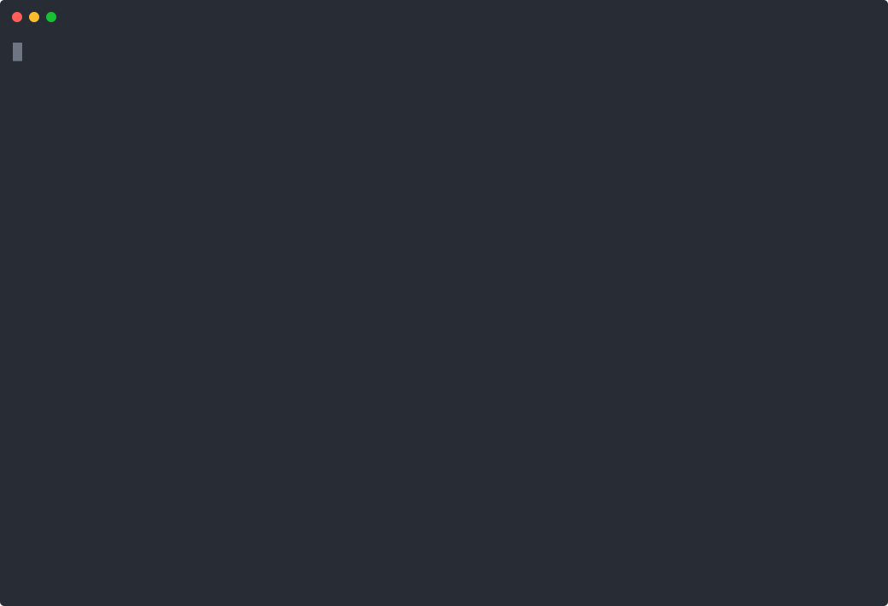
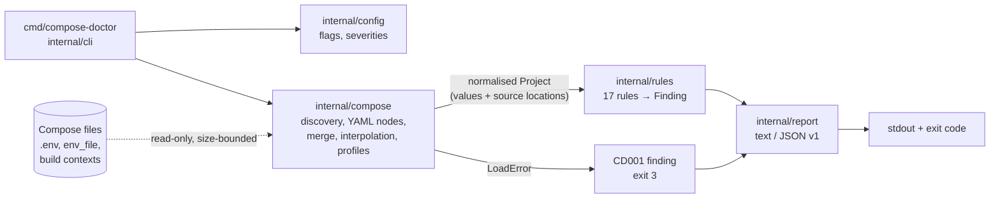

# compose-doctor

[](https://github.com/tatitoxt/compose-doctor/actions/workflows/ci.yml)
[](LICENSE)

Offline CLI that diagnoses Docker Compose projects before you start the stack.

<p align="center">
  
</p>

## Problem

Many Compose failures are only discovered at `docker compose up` time, or
worse, after the stack is "up": an `env_file` that was never copied from its
template, a `${VARIABLE}` silently replaced by an empty string, two services
publishing the same host port, a `depends_on` that waits for a database
container to *start* but not to be *ready*. `docker compose config` validates
the schema but needs Docker installed and does not explain these problems.

Compose Doctor reads the project files, never starts anything, and reports
each problem with a stable rule ID, file:line:column, evidence and a
concrete suggestion. Its JSON output and exit codes are meant for CI.

## What it does today

- Loads a project like Docker Compose v2 does: `compose.yaml` /
  `docker-compose.yml` discovery plus the `*.override.yaml` file, or
  explicit repeated `-f` files merged in order; YAML anchors, aliases and
  merge keys (`<<`); `!reset` / `!override` tags; profiles (`--profile`,
  `COMPOSE_PROFILES`); `include:` (merged before the including file) and
  service-level `extends:` across files, both with cycle detection.
- Interpolates `$VAR`, `${VAR}`, `${VAR:-default}`, `${VAR-default}`,
  `${VAR:?err}`, `${VAR?err}`, `${VAR:+alt}`, `${VAR+alt}`, nested defaults
  and `$$` escapes, from the shell environment and the project `.env`
  (or `--env-file`).
- Runs 17 rules (table below) and reports findings in human-readable text,
  JSON (`--format json`, schema version 1) or SARIF 2.1.0
  (`--format sarif`) for code-scanning integrations, sorted deterministically.
- Opt-in advisory rules (`--advisory`, CD6xx) flag missing operational
  hardening: no `restart` policy, no `deploy.resources.limits`, unpinned
  image tags.
- `--strict` turns findings at or above `--fail-on` (default `warning`) into
  exit code 1; `--disable CD402,...` skips rules.
- Inline ignore directives suppress findings next to the line they excuse:
  `image: nginx  # compose-doctor:ignore CD102` (trailing comment, that
  line only), `# compose-doctor:ignore CD102 CD401` on its own line (the
  next entry), a bare `# compose-doctor:ignore` (all rules on that line)
  and `# compose-doctor:ignore-file` (the whole file). Suppressed findings
  are counted on stderr.
- `check --fix` rewrites findings marked fixable in place — CD003
  (`version:` key removal) and CD601 (inserts `restart: unless-stopped`)
  — and reports each edit on stderr before printing the remaining
  findings. Fixes are limited to edits Compose tolerates (dropping an
  ignored key, adding a valid key), so a valid file stays valid.
- Baseline files adopt legacy projects: `check --write-baseline` records the
  current findings to `compose-doctor-baseline.json` (or `--baseline PATH`);
  later runs suppress findings matching rule + file + message (line drift is
  tolerated), while new violations still surface. Entries that stop matching
  are reported for pruning.
- Per-project tuning: `compose-doctor.json` beside the Compose file
  re-severities or disables rules (`{"severity": {"CD402": "off",
  "CD102": "info"}}`). `--config` points elsewhere; `--disable` unions
  with the file's `off` entries. `CD001` cannot be disabled or
  re-severitied — it reports input that cannot be analysed.
- Never prints variable values: only names, paths and the raw text of the
  file. Never runs Docker, a shell or containers, or opens
  network connections (the binary does not link `net` or `os/exec`; a test
  enforces this). The only write is the opt-in `check --fix` rewrite plus
  `--write-baseline`, both limited to files inside the project directory.
- Bounds hostile input: 4 MiB per Compose file, 1 MiB per auxiliary file,
  YAML nesting depth 100, alias chain depth 32; only regular files are read.

### Rules

| ID | Name | Severity | Example trigger |
|----|------|----------|-----------------|
| CD001 | invalid-input | error | invalid YAML, missing or oversized file (exit 3) |
| CD002 | service-without-image-or-build | error | service with only `restart:` |
| CD003 | obsolete-version-key | info | `version: "3.8"` (fixable with `--fix`) |
| CD004 | duplicate-key | error | `environment:` twice in one service |
| CD101 | env-file-not-found | error | `env_file: ./web.env` that does not exist |
| CD102 | build-context-not-found | error | `build: ./backend` missing, or its Dockerfile |
| CD103 | bind-source-not-found | warning | `./static:/usr/share/nginx/html` missing |
| CD104 | watch-path-not-found | warning | `develop.watch` `path: ./src` missing |
| CD201 | undefined-variable | warning | `${PG_TAG}` set nowhere |
| CD202 | required-variable-unset | error | `${DB_PASSWORD:?...}` unset |
| CD203 | invalid-interpolation | error | `"${UNCLOSED"` |
| CD301 | host-port-conflict | error | two services publishing `8080/tcp` |
| CD302 | invalid-port | error | `"80800:80"` |
| CD401 | depends-on-undefined-service | error | `depends_on: [search]` with no `search` service |
| CD402 | depends-on-without-readiness | info | `depends_on: [db]` without `condition: service_healthy` |
| CD403 | healthy-condition-without-healthcheck | warning | `service_healthy` on a service with no healthcheck |
| CD501 | undefined-volume | error | named volume not declared at top level |
| CD502 | undefined-network | error | network not declared at top level |
| CD601 | restart-policy-missing | info | advisory; fixable with `--advisory --fix` |

Details, false-positive guards and certainty notes: [docs/rules.md](docs/rules.md).

## Quickstart

Requires Go 1.23 or newer (CI uses Go 1.26.11). No Docker needed.

```sh
git clone https://github.com/tatitoxt/compose-doctor.git
cd compose-doctor
go build -o bin/compose-doctor ./cmd/compose-doctor

# Diagnose a synthetic project with unset variables and a broken interpolation
./bin/compose-doctor check testdata/fixtures/undefined-variables

# Same project, as JSON
./bin/compose-doctor check --format json testdata/fixtures/undefined-variables

# CI usage: exit 1 if any warning or error is found
./bin/compose-doctor check --strict testdata/fixtures/port-conflicts; echo "exit code: $?"

# Multiple files and profiles, like docker compose -f ... --profile ...
cd testdata/fixtures/multi-file && ../../../bin/compose-doctor check -f base.yaml -f prod.yaml; cd -
./bin/compose-doctor check --profile debug testdata/fixtures/profiles

# List rules
./bin/compose-doctor rules
```

Example output (`check testdata/fixtures/missing-files`, abridged):

```text
Checked compose.yaml

compose.yaml:3:12  error    CD102  service "api": build context "./backend" not found
    hint: Check the path; build contexts are resolved from the project directory.
compose.yaml:10:15  error    CD101  service "web": env_file "./web.env" not found
    hint: A template exists: copy "./web.env.example" to "./web.env" and fill in local values. ...
compose.yaml:12:9  warning  CD103  service "web": bind mount source "./static" does not exist
    hint: Docker creates a missing short-syntax bind source as an empty, root-owned directory, which usually hides a typo. ...

6 findings (4 error, 2 warning, 0 info)
```

The complete expected outputs of every fixture are in
[testdata/golden/](testdata/golden/).

### Usage

```text
compose-doctor check [flags] [path]   path: project directory (default ".") or a Compose file
  -f, --file FILE        Compose file, repeatable; later files override earlier ones
  --profile NAME         enable a profile, repeatable ("*" enables all)
  --env-file FILE        env file for interpolation instead of <project>/.env
  --ignore-os-env        do not read variables from the process environment
  --format human|json|sarif   output format (default human)
  --strict               exit 1 when a finding at or above --fail-on is reported
  --advisory             also run advisory rules (CD6xx: restart policy, resource limits, image pinning)
  --fail-on SEVERITY     info, warning or error (default warning)
  --disable IDS          comma-separated rule IDs to skip, repeatable
  --config FILE          per-project rules file (default: <project>/compose-doctor.json)
  --baseline FILE        suppress findings recorded in the baseline (default:
                         <project>/compose-doctor-baseline.json when present)
  --write-baseline       record current findings to the baseline file and exit
  --fix                  rewrite fixable findings in place (CD003)
compose-doctor rules [--format json]
compose-doctor version
```

| Exit code | Meaning |
|-----------|---------|
| 0 | analysis completed (findings may exist when `--strict` is off) |
| 1 | `--strict` and at least one finding at or above `--fail-on` |
| 2 | usage error (unknown flag, format, severity or rule ID) |
| 3 | input could not be analysed (`CD001`: missing file, invalid YAML, limits) |

### JSON output

```json
{
  "schema_version": 1,
  "tool": "compose-doctor",
  "version": "dev",
  "files": ["base.yaml", "prod.yaml"],
  "profiles": [],
  "findings": [
    {
      "rule_id": "CD301",
      "rule": "host-port-conflict",
      "severity": "error",
      "message": "host port 3000/tcp is published twice by services \"api\" and \"web\": ...",
      "location": {"file": "prod.yaml", "line": 3, "column": 13},
      "evidence": {"service": "web", "port": "3000:80", "other_service": "api", "...": "..."},
      "suggestion": "Only one mapping can bind a host port. ..."
    }
  ],
  "summary": {"total": 2, "error": 1, "warning": 1, "info": 0}
}
```

`findings`, `files` and `profiles` are always arrays; `evidence` is omitted
when empty. Paths are relative to the project directory.

### SARIF output

`--format sarif` emits a single SARIF 2.1.0 run: the driver catalog lists
every rule (id, name, summary, default level, link to
[docs/rules.md](docs/rules.md)) and each finding becomes a `result` with its
`ruleId`, SARIF `level` (`error`/`warning`/`note`), message plus suggestion,
and a `physicalLocation` (`artifactLocation.uri`, `region.startLine`/column
when known). Upload it with `github/codeql-action/upload-sarif` or any
SARIF viewer. Exit codes are unchanged, so `--strict --format sarif` still
fails the job after writing the log.

### GitHub Action

The repository doubles as a composite action: it downloads the tagged release
binary, verifies it against `checksums.txt`, puts it on `$GITHUB_PATH` and runs
`check` on `path` with `args` passed verbatim.

```yaml
- uses: tatitoxt/compose-doctor@v1
  with:
    args: --strict --format sarif -o results.sarif
- uses: github/codeql-action/upload-sarif@v3
  if: always()
  with:
    sarif_file: results.sarif
```

Set `install-only: 'true'` to install without running `check`, or `version`
to pin a release tag other than the latest.

## Architecture



- `internal/compose` parses with `gopkg.in/yaml.v3` at the node level to keep
  line/column information, then builds a small normalised model containing
  only what the rules need. Each value keeps its raw text, its interpolated
  value (used only for checks such as path existence and port comparison) and
  its location.
- `internal/rules` are pure functions `Project → []Finding`; they only call
  `os.Stat` for path checks.
- Design decisions: [YAML parser](docs/adr/0001-yaml-parser.md),
  [interpolation and secrets](docs/adr/0002-interpolation-and-secrets.md),
  [severity and exit codes](docs/adr/0003-severity-and-exit-codes.md).
  Specification and acceptance scenarios: [docs/spec](docs/spec/README.md).

## Tests

```sh
go test ./...                 # everything: unit, golden/integration and E2E
go test ./internal/...        # unit + integration (golden files)
go test ./e2e/...             # E2E: builds the binary and runs it in temp dirs
go test -race ./...
make lint                     # gofmt, go vet, staticcheck
make vuln                     # govulncheck
make fuzz                     # 30 s per fuzz target
make golden                   # regenerate golden files after an intended change
```

- **Unit:** interpolation, dotenv parsing, YAML limits and merge keys, flag
  parsing, report rendering, and table tests per rule with positive and
  false-positive cases.
- **Integration (golden):** `internal/cli/golden_test.go` runs the CLI on
  every project in `testdata/fixtures/` (multi-file, overrides, profiles,
  anchors, escapes, invalid input) and compares exit code, text and JSON with
  `testdata/golden/`. It also asserts that no value from any fixture env file
  appears in the output.
- **E2E:** `e2e/` builds `cmd/compose-doctor`, copies fixtures into temp
  directories, runs the binary with a minimal environment and checks stdout,
  stderr, exit codes, JSON validity and that no file was created, changed or
  touched (mode, size, mtime and SHA-256 snapshot).
- **Fuzz:** `FuzzInterpolate` and `FuzzLoad` (no panics, only typed errors).

Measured in this repository on Linux with Go 1.26.11
(`go test -count=1 -v ./... | grep -c '^--- PASS'`): 69 top-level tests,
175 including subtests, all passing. CI runs the same suites on Ubuntu and
macOS, with `-race`, plus staticcheck and govulncheck.

## Limitations

- Not a schema validator: unknown keys are ignored and only the fields used by
  the rules are modelled. `x-*` extension keys are skipped per the Compose
  spec (they carry anchors and metadata, not config), and `develop.watch`
  is modelled only for path checking (CD104). Run `docker compose config`
  for full validation.
- `include:` and `extends:` are resolved as Docker Compose does (include
  merges before the parent file; extends inherits service fields, with
  cycle detection). Files under `include:` or `extends: file:` are still
  scanned only for the keys they contribute to the project — not linted
  as standalone projects.
- Image metadata is not available offline: a Dockerfile `HEALTHCHECK` is
  invisible (hence CD403 is a warning), and ports already in use on the host
  are not detected.
- Absolute bind-mount paths are not checked; only relative ones.
- YAML syntax error positions come from `yaml.v3` and sometimes point to the
  start of the enclosing block rather than the offending line (see
  `testdata/golden/invalid-yaml.txt`).
- CI runs on Linux and macOS only; Windows paths are handled in code
  (`SplitShortVolume` drive letters) but not tested on Windows.
- `--fix` covers only findings it can rewrite without judgement calls
  (dropping `version:`, adding a restart policy); everything else is
  reported for a human to decide. Release binaries build via GoReleaser
  when a tag is pushed; until the first tag, build from source.
- The rule set is small and opinionated; severities reflect the author's
  judgement documented in docs/rules.md, not measured false-positive rates.

## Roadmap


## License

[MIT](LICENSE) © Fausto Pastura
